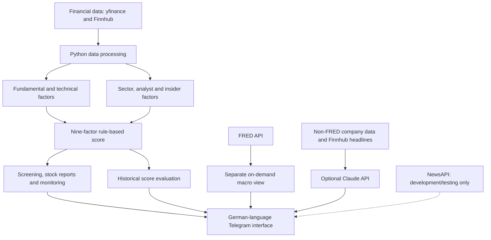

# Project Purple — Stock Analysis & Screening Bot

**A Python-based Telegram bot for personal stock research, combining rule-based multi-factor scoring, automated screening, backtesting, and an optional AI-powered interpretation of financial data.**

> **Interface:** German · **Documentation:** English  
> **Development:** AI-assisted / vibe-coded · **Model:** Rule-based, not trained machine learning  
> **Status:** **Work in progress** · Personal research prototype, not investment advice

## Overview

Project Purple is a personal project I developed to explore how financial data can be collected, analysed, and presented through an interactive Telegram interface. It combines company fundamentals, valuation, financial quality, technical indicators, sector comparisons, analyst sentiment, and insider activity into a transparent, configurable stock score.

The current scoring profile is designed as a **medium- to long-term (approximately 3–7 years) quality–growth–value research framework**, with trend and momentum as secondary signals. It assumes **high equity risk tolerance**; this is an intended research profile, not an empirically measured risk classification.

**FRED macroeconomic data is available separately on demand through `/macro`. It is not part of the weighted stock score, saved stock reports, historical score records, or Claude prompts.** Project Purple does not place trades or claim to predict returns.

## Key features

| Area | Functionality |
| --- | --- |
| **Multi-factor stock scoring** | Nine configurable factors covering valuation, growth, profitability, balance-sheet strength, trend, momentum, analyst sentiment, insider activity, and sector comparisons |
| **Technical analysis** | Moving averages, RSI, MACD, momentum, 52-week price ranges, and volume |
| **Fundamental analysis** | Valuation ratios, financial performance, cash flow, leverage, and growth metrics |
| **Stock screening** | Automated candidate filtering and ranking, including a two-stage screening workflow |
| **Sector benchmarking** | Relative comparisons against a sample of industry peers |
| **Independent macro view** | On-demand FRED economic indicators and a separate macro-regime assessment through `/macro` |
| **Interactive Telegram reports** | Score breakdowns, company fundamentals, charts, analyst information, news, and earnings context |
| **Personal monitoring** | Watchlists, price alerts, score changes, and scheduled briefings |
| **Historical evaluation** | Portfolio and individual-stock backtesting, plus prospective score-history collection |
| **Optional Claude commentary** | AI-generated stock commentary based on non-FRED financial inputs and company news from Finnhub |
| **Offline checks** | Automated smoke tests for selected data-flow restrictions and scoring-weight invariants |

### How the scoring model works

The model combines **nine rule-based sub-scores**, each typically ranging from 0 to 100. It applies fixed, manually selected weights to calculate a composite rating. When an input is missing, the live scoring logic may assign a **neutral 50/100**, which is a known methodological limitation.

#### Current factor weighting

| Factor | Weight |
| --- | ---: |
| Valuation | **20%** |
| Growth | **22%** |
| Profitability | **20%** |
| Balance-sheet strength | **15%** |
| Trend | **6%** |
| Momentum | **7%** |
| Analyst sentiment | **3%** |
| Insider activity | **2%** |
| Sector peer comparison | **5%** |
| **Total** | **100%** |

The distribution emphasizes **fundamentals (77%)**, supported by **technical factors (13%)**, **analysts and insiders (5%)**, and **sector comparisons (5%)**.

I adjusted the weights to reflect the intended longer-term quality/growth/value approach, giving profitability and growth more influence while reducing reliance on potentially noisy or overlapping analyst and insider signals. **These percentages are heuristic design assumptions, not historically optimized or independently validated weights.** They do not establish that the revised model performs better.

FRED does **not** contribute to these weights. The previous 10% macro allocation was removed to separate the stock-scoring process from restricted external economic data.

For the detailed rationale and outstanding research questions, see [WEIGHTING_NOTES.md](WEIGHTING_NOTES.md).

## Architecture



The FRED branch is deliberately separate from the stock-scoring and Claude branches. NewsAPI is disabled by default and is **not** required for company news, which is retrieved independently through Finnhub.

### Technology stack

- **Core and data processing:** Python, pandas, NumPy
- **Charts:** Matplotlib
- **Equity data:** yfinance, Finnhub
- **On-demand macroeconomic context:** FRED
- **Additional integrations:** DBnomics; NewsAPI (development and testing only)
- **Telegram interface and scheduled tasks:** `python-telegram-bot`
- **Optional generative AI:** Anthropic Claude API
- **Configuration:** `python-dotenv` and local environment variables

## Telegram experience

The bot's user interface is primarily **German**, including interactive menus, command descriptions, reports, and notifications. Ticker symbols and some financial terminology remain in English.

| Command | Purpose |
| --- | --- |
| `/menu` | Open the interactive menu |
| `/check AVGO` | Analyse a US-listed stock |
| `/tts` | Run the stock screener |
| `/compare AVGO NVDA` | Compare two stocks |
| `/chart AVGO` | Display a stock-price chart |
| `/watchlist` | Review the personal watchlist |
| `/alert AVGO 250` | Create a price alert in USD |
| `/backtest` | Open historical backtesting functions |
| `/macro` | Request a fresh, separate FRED macroeconomic view |
| `/news AVGO` | Retrieve company-specific news through Finnhub |
| `/ai AVGO` | Request optional Claude commentary, excluding FRED data |
| `/id` | Show your Telegram user ID for local access configuration |

### Screenshots

[View Project Screenshots](https://github.com/robinddavid/finance_analysis/tree/main/screenshots)

## Getting started

**Requirements:** Python 3, your own Telegram bot token, and credentials for the external services you enable. Provider access, pricing, and licensing depend on your individual account and intended use.

### 1. Create a Telegram bot

1. Open [@BotFather](https://t.me/BotFather) in Telegram.
2. Send `/newbot`, choose a display name, and select a unique username ending in `bot`.
3. Copy the Telegram bot token and keep it private.

See the [official Telegram bot tutorial](https://core.telegram.org/bots/tutorial) for details.

### 2. Install Project Purple

```bash
git clone https://github.com/robinddavid/finance_analysis.git
cd finance_analysis

python3 -m venv .venv
source .venv/bin/activate       # macOS/Linux
# .venv\Scripts\Activate.ps1   # Windows PowerShell

pip install -r requirements.txt
cp .env.example .env            # macOS/Linux
```

On Windows, copy `.env.example` to `.env` manually if the `cp` command is unavailable.

### 3. Configure your local `.env`

Use your own credentials and never upload your actual `.env` file:

```dotenv
TELEGRAM_BOT_TOKEN=your_telegram_bot_token
FINNHUB_API_KEY=your_finnhub_api_key
FRED_API_KEY=your_fred_api_key
ANTHROPIC_API_KEY=
ALLOWED_USER_IDS=

# Keep NewsAPI disabled outside genuine local development/testing.
NEWS_API_KEY=
APP_ENV=production
NEWS_API_DEV_MODE=false
```

Start the bot once with `ALLOWED_USER_IDS` empty, send `/id` to obtain your Telegram user ID, then add it to `ALLOWED_USER_IDS` in `.env` and restart. Other analysis commands remain restricted until an ID is allowlisted.

**FRED credentials must be supplied locally.** The bot does not accept or store FRED API keys sent in Telegram messages.

### 4. Run the application

```bash
python3 project_purple.py
```

The optional Claude integration requires a separate `ANTHROPIC_API_KEY`. The free NewsAPI Developer integration is **not** required for normal operation.

### 5. Run the offline tests

```bash
python3 test_compliance.py
python3 test_weighting.py
```

The included checks cover selected behaviors such as default-disabled NewsAPI access, FRED request/cache separation, exclusion of FRED from scoring and Claude prompts, key-safe errors, score-weight totals, and score-model version handling. They use simulated responses rather than real provider requests and **do not certify production behavior or legal compliance**.

## Security, API usage & data licensing

**Project Purple is intended for personal, non-commercial investment research and is not a market-data redistribution service.** Publishing source code does not grant the right to redistribute third-party data. Users must obtain their own API credentials and follow each provider's current terms, quotas, and underlying data licenses.

### NewsAPI — development and testing only

The **free NewsAPI Developer plan** is intended for development and testing, **not production**, including a privately operated production bot. Project Purple therefore disables NewsAPI requests unless all of the following are true:

- `APP_ENV=development`
- `NEWS_API_DEV_MODE=true`
- `NEWS_API_KEY` contains a valid key

These flags should only be used during genuine development/testing in an appropriate environment. **A README disclaimer or configuration flag does not authorize production use.** Company-specific headlines are obtained separately from Finnhub, subject to Finnhub's licensing conditions.

### FRED — separate, on-demand macroeconomic context

FRED observations are requested only for a user-initiated macroeconomic view, such as `/macro` or its corresponding report button. The application is designed **not to cache or persist FRED API observations**, and does not include FRED data or FRED-derived values in its saved stock scores, routine screening, or optional Claude requests.

The macro view displays the applicable FRED notice and a link to the terms. FRED and any underlying third-party series remain subject to their respective usage restrictions; users should not assume that forwarding, archiving, or redistributing displayed values is permitted.

> This product uses the FRED® API but is not endorsed or certified by the Federal Reserve Bank of St. Louis.

[Official FRED Terms of Use](https://fred.stlouisfed.org/legal/terms/)

### Claude / Anthropic — optional, non-FRED input only

When enabled, Claude receives company data and Finnhub headlines from the standard **non-FRED** stock report. It does not receive raw FRED observations, the separate macro-regime output, or a FRED-influenced aggregate score. Anthropic's own API terms and applicable rights to the input data still apply.

### Secrets and local files

- Credentials are loaded from your local `.env` or environment variables. **Never commit API keys, `.env`, tokens, or personal state files.**
- Telegram analysis commands are restricted using `ALLOWED_USER_IDS`; `/id` is available for initial setup.
- Rotate any credentials that may previously have been exposed. Removing keys from the latest commit does not delete Git history or past copies.
- Local state and caches may contain other providers' data. Follow their licensing restrictions and keep those files private.
- Acknowledgement and separation measures **reduce identified risks but do not guarantee legal compliance** for any particular account or deployment.

See [COMPLIANCE_NOTES.md](COMPLIANCE_NOTES.md) for implementation details and provider links.

## Investment strategy & model limitations

### Intended investment profile

| Attribute | Design assumption |
| --- | --- |
| **Investment horizon** | Medium to long term, approximately **3–7 years** |
| **Risk profile** | **High equity risk**; not a quantitative assessment |
| **Investment style** | Quality, growth, and value with modest trend/momentum confirmation |
| **Primary universe** | Mainly US-listed equities |
| **Portfolio backtest** | Equal-weighted candidate selection and monthly rebalancing |
| **Primary purpose** | Structured research, not intraday trading or automatic execution |

### Known limitations

- **Heuristic weights:** The 20/22/20/15/6/7/3/2/5 allocation is a design hypothesis, not an optimised or empirically proven strategy.
- **Missing data:** Neutral scoring of unavailable inputs can make incomplete company profiles appear more comparable than they are.
- **Sector differences:** Identical financial ratios and scoring thresholds do not always represent comparable quality across industries.
- **Overlapping indicators:** Valuation, expected growth, analyst sentiment, and even some fundamental measures can capture related information.
- **Backtest limitations:** Historical simulations rely on available factor proxies, assumptions about costs and rebalancing, and an imperfect candidate universe. They may contain survivorship, selection, or data-availability biases.
- **Live versus historical scoring:** The historical implementation does **not** reproduce every live sub-factor identically; favorable historical results would not validate the full live scoring model by themselves.
- **Risk management:** Comprehensive portfolio controls for sector concentration, correlations, position sizing, and volatility targeting are not yet implemented.
- **Uncalibrated thresholds:** The existing 55/70 signal thresholds have not been recalibrated for the revised scoring distribution.
- **No performance claims:** Neither the intended 3–7-year horizon nor the high-risk profile has been established through independent performance or risk testing.

### Score-version migration

The current implementation identifies its scoring model as `no_fred_quality_growth_v2`. **On the first successful startup after a model-version change, older saved `history` and `screen` entries are deleted** to prevent misleading comparisons with older FRED-influenced or differently weighted scores. Watchlists, alerts, and peer data are retained. **Back up `purple_data.json` privately before upgrading** if you need older records.

## Roadmap & work in progress

**Work in progress:** My current focus is on making the stock-scoring framework more interpretable and testable rather than presenting it as a validated return-prediction system.

- [x] **Revised factor-weight hypothesis:** Introduced a fundamental-heavy nine-factor weighting profile for the intended research horizon.
- [x] **FRED/Claude separation:** Isolated on-demand macro context from saved stock scores and AI prompts.
- [x] **Developer-only NewsAPI gate:** Disabled NewsAPI by default and restricted it to explicitly enabled development/testing.
- [x] **Initial offline regression checks:** Added compliance-oriented and weighting-invariant smoke tests.
- [ ] **Factor-weight validation:** Compare alternative weighting schemes using independent historical and out-of-sample evaluation.
- [ ] **Data-confidence scoring:** Show completeness and confidence separately from a neutral factor score.
- [ ] **Sector-specific calibration:** Refine company metrics and valuation thresholds by industry/business model.
- [ ] **Indicator redundancy:** Measure correlated factor contributions and reduce double-counting.
- [ ] **More rigorous backtesting:** Evaluate benchmark-relative returns, Sharpe ratio, maximum drawdown, transaction costs, and potential biases.
- [ ] **Live/backtest consistency:** Reduce the gap between the production scoring factors and the historical factors that can be reconstructed reliably.
- [ ] **Risk and signal calibration:** Test score thresholds, diversification, and exposure constraints before drawing conclusions about performance.
- [ ] **Codebase Modularization:** Refactor the monolithic Python script into separate components for data retrieval, financial analysis, scoring, backtesting, and Telegram interactions to improve maintainability and testability.

## My contribution & development approach

I defined the project concept, selected the financial indicators, designed their scoring logic and weights, and planned the main Telegram workflows. I used an **AI-assisted development (vibe-coding)** process to implement and refine the Python application, iteratively specifying features, reviewing outputs, testing behavior, troubleshooting issues, and adjusting the analytical framework.

This is a **personal learning and portfolio project** that combines financial research, data processing, API integrations, automation, model design, and practical experience working with AI-assisted software development.

## Disclaimer

**For educational and analytical use only.** Project Purple does not provide personalised investment advice, guarantee returns, or execute trades. Its ratings, fair-value estimates, and AI commentary are experimental and may be incomplete or wrong. Investment decisions require independent research and an assessment of personal risk.
