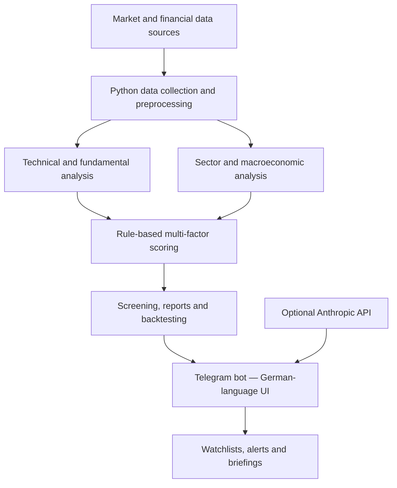

# Project Purple — Stock Analysis & Screening Bot

**A Python-based financial analytics project combining multi-factor stock scoring, automated screening, macroeconomic data, backtesting, and an interactive Telegram interface.**

> **Interface language:** German 🇩🇪 · **Documentation:** English 🇬🇧  
> **Development approach:** AI-assisted / vibe-coded · **Scoring approach:** Rule-based, not a trained machine-learning model

## Overview

Project Purple is a personal project for exploring how financial data from multiple sources can be collected, processed, scored, and delivered through a conversational interface. It brings together technical indicators, company fundamentals, sector comparisons, analyst sentiment, insider transactions, and macroeconomic indicators to produce an explainable composite score for individual stocks.

The bot is designed for hands-on analysis and experimentation, **not automated trading or investment advice**.

## Key features

| Area | Functionality |
| --- | --- |
| **Multi-factor scoring** | Configurable weighted scoring across valuation, growth, profitability, balance-sheet strength, trend, momentum, analyst sentiment, insider activity, sector comparisons, and macroeconomic conditions |
| **Technical analysis** | RSI, MACD, moving averages, price momentum, 52-week ranges, and trading volume |
| **Fundamental analysis** | Company valuation, financial performance, growth, cash flow, and leverage metrics |
| **Market context** | Sector-relative comparisons and macroeconomic indicators, including data from FRED |
| **Stock screening** | Automated ranking and filtering of stock candidates, including a two-stage screening workflow |
| **Interactive reports** | Telegram menus for score breakdowns, technicals, fundamentals, news, charts, and more |
| **Monitoring** | Personal watchlists, price alerts, score-change notifications, and scheduled market briefings |
| **Testing** | Historical backtesting and ongoing collection of score history for prospective evaluation |
| **Optional AI commentary** | Natural-language stock commentary through the Anthropic API, when configured |

**How scoring works:** The composite rating is calculated from weighted, rule-based sub-scores. Missing inputs may receive a neutral score. The output is a heuristic analytical indicator, **not a prediction of stock returns or a trained ML model**.

## Architecture



### Technology stack

- **Core:** Python, pandas, NumPy
- **Visualisation:** Matplotlib
- **Market and economic data:** yfinance, Finnhub, NewsAPI, FRED, DBnomics
- **Interface and automation:** python-telegram-bot, scheduled jobs
- **Optional generative AI:** Anthropic API
- **Configuration:** environment variables via `python-dotenv`

## Telegram experience

The **Telegram user interface is primarily in German**, including command descriptions, navigation buttons, notifications, and analysis reports. Stock symbols, common financial abbreviations, and some technical terminology remain in English.

Selected commands:

| Command | Purpose |
| --- | --- |
| `/menu` | Open the interactive navigation menu |
| `/check AVGO` | Analyse an individual stock |
| `/tts` | Run the stock screen |
| `/compare AVGO NVDA` | Compare two stocks |
| `/chart AVGO` | Display a price chart |
| `/watchlist` | View saved stocks and scores |
| `/alert AVGO 250` | Create a price alert |
| `/backtest` | Open historical backtesting |
| `/macro` | View macroeconomic analysis |
| `/ai AVGO` | Request optional AI commentary (requires configuration) |

### Screenshots

*Add screenshots of the Telegram dashboard, an example stock report, and a backtest here. Remove or blur usernames, chat IDs, API credentials, and any personal portfolio details before publishing.*

## Getting started

**Prerequisites:** Python 3 and a Telegram bot token. External data services may require API credentials, quotas, or subscriptions.

1. Clone the repository and enter its directory.
   ```bash
   git clone https://github.com/YOUR_USERNAME/project-purple.git
   cd project-purple
   ```
2. Create and activate a virtual environment.
   ```bash
   python -m venv .venv
   source .venv/bin/activate  # macOS/Linux
   # Windows PowerShell: .venv\Scripts\Activate.ps1
   ```
3. Install dependencies.
   ```bash
   pip install -r requirements.txt
   ```
4. Copy `.env.example` to `.env`. Replace example values with your **own newly issued credentials**. Do not commit `.env`.
5. Start the bot to obtain your Telegram user ID using `/id`, then add that ID to `ALLOWED_USER_IDS` in `.env` and restart. Without an allowlisted ID, analysis functions remain locked.
6. Launch the application.
   ```bash
   python project_purple.py
   ```

**Configuration:** `TELEGRAM_BOT_TOKEN`, `FINNHUB_API_KEY`, `NEWS_API_KEY`, `FRED_API_KEY`, optional `ANTHROPIC_API_KEY`, and `ALLOWED_USER_IDS`. Refer to `.env.example` for the exact format. Never publish actual keys.

## Development approach: AI-assisted / vibe-coded

Project Purple was built using an **AI-assisted development workflow (commonly called “vibe coding”)**. AI tools supported code generation and iteration while the project focused on bringing together financial-data sources, scoring logic, and Telegram-based workflows into a working prototype.

This disclosure describes **how the software was developed**; it does **not** mean that the multi-factor score itself is generated by an LLM. Core stock ratings are rule-based. Generative-AI commentary is an optional, separate feature.

## Security and responsible use

- API credentials are loaded from environment variables and excluded from version control.
- Local settings, cached user data, and secret files should remain private.
- Access to bot analysis commands is restricted using Telegram user IDs.
- Rotate any credentials that may previously have been exposed; removing them from the current code does not erase earlier Git commits or copies.
- Review third-party data-provider licensing, rate limits, and terms before broader deployment.

This repository is a **personal learning and portfolio project**. It is not presented as a production-grade financial service. Running it reliably in production would require further integration testing, operational monitoring, and security review.

## Limitations

- Financial data can be delayed, incomplete, inconsistent, or restricted by provider API limits.
- The score is a heuristic and its thresholds and weights are subjective design choices.
- Missing data may be scored neutrally and can affect comparisons.
- Backtesting is sensitive to survivorship bias, publication lag, transaction costs, and assumptions about historical data availability.
- A simulated result does not establish future predictive performance.

## Disclaimer

**For educational and analytical purposes only.** Project Purple does not provide personalised investment advice, guarantee returns, or place trades. All investment decisions require independent research and consideration of risk.
